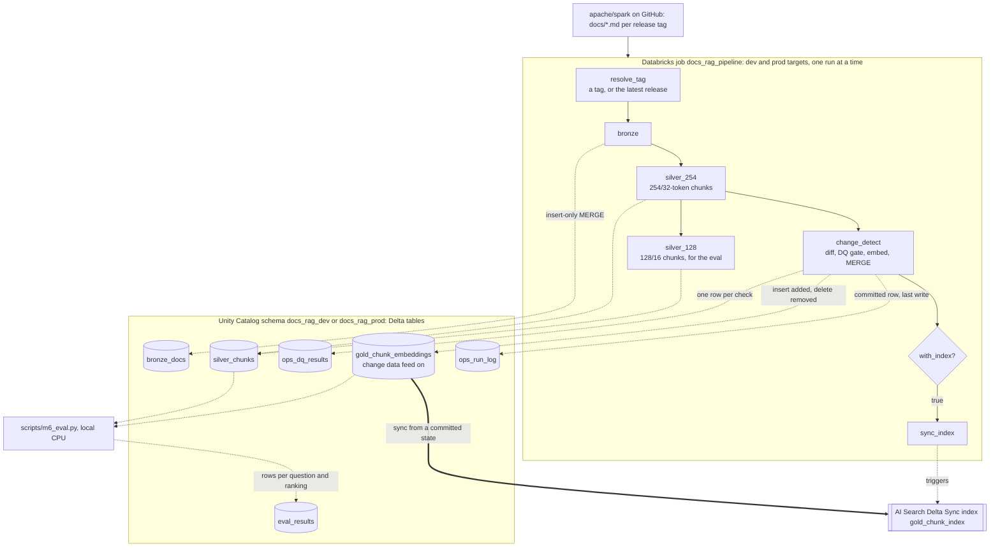
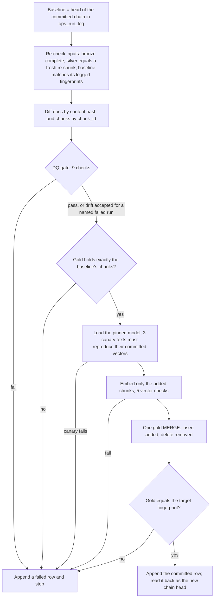

# Spark Docs RAG Pipeline

An incremental ingestion pipeline that keeps a vector index in step with a changing document corpus, plus a
harness that measures how well the index retrieves. The corpus is the Apache Spark documentation (the Markdown
under `docs/` in [apache/spark](https://github.com/apache/spark)), one release tag at a time.

It runs on Databricks Free Edition: serverless jobs, Unity Catalog, Delta tables in a bronze/silver/gold
layout, and a Databricks AI Search (formerly Vector Search) Delta Sync index. It is deployed with Databricks
Asset Bundles to a dev and a prod target, with tests and deploys in GitHub Actions.

**Every number in this README comes from a run whose raw output is committed under [`runs/`](runs/)**. The
file is named next to the number. The reasoning behind each design choice, with the options considered, is in
[`DECISIONS.md`](DECISIONS.md) (D-001 to D-016).

## Results at a glance

- **Only changed content is embedded.** Three upgrades took dev from v3.5.0 to v4.2.0. Across them, 2,689 of
  the 16,910 chunks in the three target releases were embedded (15.9%). The patch release v4.0.1 needed 21 of
  5,436 (0.39%).
- **The incremental path ends where a full load ends.** Dev reached v4.2.0 through those upgrades, and prod
  loaded v4.2.0 from empty. Both gold tables hold the same 6,051 chunk IDs (fingerprint `671b1434…`). Dev's
  stored vectors rank the eval exactly as a fresh embedding does (lowest cosine 0.99997).
- **Re-runs change nothing.** Every re-run on the same input logged 0 added, changed and deleted documents,
  embedded nothing and wrote no new gold version. This holds at each layer and for the whole job in dev and prod.
- **A data-quality gate stops bad loads before publishing.** It runs 9 chunk checks and 5 vector checks, with
  thresholds calibrated over 42 Spark releases. It stopped both feature-release upgrades of the dev chain on
  drift, before anything was embedded. An override has to name the failed run and accept that
  run's exact numbers.
- **Retrieval, measured on 50 owner-reviewed questions:** the production config (all-MiniLM-L6-v2, 254-token
  chunks) has recall@5 0.68 [0.54, 0.80] and MRR@10 0.486 at v4.0.1. No other configuration beat it on
  recall@5 by more than the set can resolve. The live ANN index returned 99.8% of exact search's top 10.
- **Cost on Free Edition:** a full pipeline run (initial load of 6,051 chunks) billed 1.23 DBU and a no-op run
  0.36 DBU. A vector endpoint billed 96 DBU per idle day, so the index is created only for demos.

## Architecture



| Table | One row per | Key | Written by |
|---|---|---|---|
| `bronze_docs` | doc file of a tag: raw content, sha256, size, commit | `source_repo, version_tag, path` | `bronze`: insert-only MERGE, skipped when the tag is already stored identically |
| `silver_chunks` | chunk of a doc of a tag, per chunk config (254/32 and 128/16) | `config_id, source_repo, version_tag, chunk_id` | `silver_254`, then `silver_128`: insert-only MERGE, skipped when identical |
| `gold_chunk_embeddings` | published chunk of the chain's head tag, with its 384-dim vector, model@revision and the run that embedded it | `chunk_id` (the index's primary key) | `change_detect`: one MERGE per run that inserts and deletes, never updates |
| `ops_run_log` | change-detection attempt, `committed` or `failed`; committed rows form a chain through `baseline_run_id` | `run_id` (append-only) | `change_detect`, as its last write |
| `ops_dq_results` | DQ check of a run attempt | `run_id, attempt_id, check_name` (append-only) | `change_detect` |
| `eval_results` | eval question × ranking (model, query prefix, chunk config, vectors) | 6 columns, insert-only MERGE | `scripts/m6_eval.py --write-table` (dev only) |

### Inside `change_detect`: write, audit, publish

The task that touches gold checks everything first and writes gold once. The commit row is its last write, so
a crash anywhere before it leaves no committed run behind.



Every failure before the MERGE leaves gold as it was. A failure after it (the last two steps) leaves gold
ahead of the chain, which the next run detects and refuses; see Limitations. When nothing was added or
removed, the run skips the model, the vector checks and the MERGE.

## How it works

**Bronze (D-006, D-007).** For a tag, the job downloads the source archive in one request and keeps
`docs/**/*.md`. It checks the archive is complete and takes the commit from the archive header. Each file is
stored with its path, tag, commit, size and the sha256 of its raw bytes. A tag is an immutable snapshot: a
re-run with identical content skips the MERGE, because Delta writes an empty table version even when a MERGE
changes nothing (`runs/m1_b_*`).

**Silver (D-008 to D-010).** The Jekyll/Liquid markup is cleaned to plain Markdown text. Pages are then split
on their headings, and each section into chunks bounded in the embedding model's own WordPiece tokens. Chunks
never cross a section. Each chunk's embed text is its heading breadcrumb plus its body. Its `chunk_id` is a
hash of the doc path, the section path, that exact text and an occurrence counter, with no tag or position in
it. So an unchanged section keeps its IDs in every release. Chunk size and overlap are configurable: 254/32 is
published, and 128/16 exists for the eval. The cleaner and chunker are versioned, and crossing a version is an
explicit re-baseline (D-013).

**Change detection (D-011).** A run compares the target tag with the head of the chain of committed runs in
`ops_run_log`, not with the latest timestamp. Docs are diffed by content hash into added, changed, deleted and
unchanged. Chunks are diffed by ID: added IDs are embedded, removed IDs are deleted from gold, kept IDs are left
alone. Every run logs its counts, committed or failed.

**DQ gate (D-012).** These checks run on all of the target's chunks before anything is published:

| Check | Fails when |
|---|---|
| `empty_chunks` | any chunk has no tokens |
| `tiny_chunks` | more than 2% of chunks have bodies under 5 tokens |
| `oversized_chunks` | any chunk is over the config's limit or the model's 254-token window |
| `duplicate_chunk_ids` | any chunk ID repeats |
| `duplicate_embed_text` | more than 1% of chunks are copies of another chunk's text |
| `missing_metadata` | a chunk has a bad path, a blank section name, the wrong tag, or a malformed commit |
| `drift_docs`, `drift_chunks`, `drift_tokens` | the total moves more than 5% (patch release) or 10% (minor or major) from the baseline |
| vector checks (5) | added vectors missing or extra, wrong dimension, non-finite, not unit length, or the canary texts not reproducing their vectors |

A drift failure can be accepted. The operator re-runs with a reason and the failed run's ID, and the gate
accepts only that run's exact numbers. A loss over 50% and any non-drift check cannot be overridden.

**Gold and the index (D-014).** Embeddings come from `sentence-transformers/all-MiniLM-L6-v2` at a pinned
revision, on CPU torch pinned by sha256. They are computed by the job, and a shipped canary catches a changed
model or library. Gold rows are immutable, and each carries the run that embedded it, so a verifier can prove
which rows a run wrote. The index is a Delta Sync index with self-managed embeddings over gold, synced only
from a committed state. It is a replica, so a failed sync leaves the run committed and is simply run again.

**Retrieval eval (D-015).** 50 questions, one per sampled doc section. An LLM (Claude) drafted them, a second
skeptical pass checked them, and the owner reviewed every item. Each item is labelled by a verbatim quote from
the docs, not by chunk IDs. A chunk is relevant if it covers at least half of an occurrence of the quote, so
one label works for every chunk size. Search is exact cosine over all chunks. Uncertainty comes from a paired
bootstrap (10,000 resamples), and the decision rule was committed before the first run.

**Orchestration and deployment (D-016).** One bundle (`databricks.yml`, `resources/pipeline.job.yml`) deploys
one job per target. The `tag` parameter defaults to `latest`, which resolves to the newest plain release from
git's ref list, so a weekly schedule would pick up new Spark releases by itself. The schedule is paused,
because every run uses quota. A deploy builds the wheel from the current commit, and every task refuses to run
unless it imports exactly that version on serverless environment 4. GitHub Actions runs lint, types and tests
on every push and pull request. It deploys dev on each push to `main` that touches deployed code, and deploys
prod on demand.

## Results

### Incremental processing (dev gold chain, 254/32, all-MiniLM-L6-v2)

| Run | Step | Docs added / changed / deleted | Chunks embedded | Kept | Removed | Share embedded |
|---|---|---|---|---|---|---|
| [`m5_c`](runs/m5_c_detect_v3.5.0_initial.json) | initial load, v3.5.0 | 244 / 0 / 0 | 5,567 | 0 | 0 | 100% |
| [`m5_h`](runs/m5_h_detect_v4.0.0_accepted.json) | v3.5.0 → v4.0.0 (major) | 19 / 96 / 51 | 1,866 | 3,557 | 2,010 | 34.4% |
| [`m5_j`](runs/m5_j_detect_v4.0.0_rerun.json) | v4.0.0 again | 0 / 0 / 0 | 0 | 5,423 | 0 | 0% |
| [`m5_k`](runs/m5_k_detect_v4.0.1.json) | v4.0.0 → v4.0.1 (patch) | 1 / 4 / 0 | 21 | 5,415 | 8 | 0.39% |
| [`m7_d`](runs/m7_d_dev_v4.2.0_accepted_detect.json) | v4.0.1 → v4.2.0 (minor, via the bundle job) | 25 / 57 / 0 | 802 | 5,249 | 187 | 13.3% |
| [`m7_e`](runs/m7_e_dev_latest_again_detect.json) | `latest` (v4.2.0) again | 0 / 0 / 0 | 0 | 6,051 | 0 | 0% |

"Share embedded" is the number of chunks embedded divided by the chunks at the target. By tokens, the shares
are 31.2%, 0.51% and 14.1% for the three upgrades. The gate stopped two runs on drift before these:
[`m5_d`](runs/m5_d_detect_v4.0.0_drift.json) (v4.0.0: docs −13.1%) and
[`m7_b`](runs/m7_b_dev_latest_detect.json) (v4.2.0: docs +11.7%, chunks +11.3%, tokens +12.1%). The upgrades
above are their accepted re-runs.

### The same release, incremental and full

| | Dev: incremental from v4.0.1 ([`m7_d`](runs/m7_d_dev_v4.2.0_accepted.json)) | Prod: full load from empty ([`m7_g`](runs/m7_g_prod_initial.json)) |
|---|---|---|
| Chunks embedded | 802 | 6,051 |
| Encoding time | 30.9 s | 220.7 s |
| `change_detect` task | 168 s | 340 s |
| Whole job | 308 s | 455 s |
| Billed DBU for the job run ([`m7_l`](runs/m7_l_billing_m7_runs.json)) | 0.57 | 1.23 |
| Gold after the run | 6,051 chunks, fingerprint `671b1434…` | 6,051 chunks, fingerprint `671b1434…` |

These figures are from one run each. Bronze and silver for dev's v4.2.0 were written by `m7_b`, the run the gate
stopped (0.82 DBU). Counting it, dev's path to v4.2.0 billed 1.39 DBU, more than prod's full load. At about
6,000 chunks, embedding is roughly half of a full run (221 of 455 s). In the incremental run it was 31 of
308 s. The rest is work that does not shrink with the change: task start-up and package installs, re-checking
silver against a fresh re-chunk, and the gate. Those were not timed separately. What incremental processing
buys at this size is a gold table and index that change only where the docs changed, with per-vector
lineage. That the compute saving grows with corpus size is an inference; it was not measured here.

### Data-quality gate

| Evidence | Result |
|---|---|
| Calibration over every final release from v3.0.0 to v4.2.0, git only ([`m4_a`](runs/m4_a_calibration.json)) | No count check fired on any of 42 releases. Drift at 10% fired on 3 of 41 transitions, all feature releases; no patch release moved more than 2.2%. The thresholds are 5% for a patch release and 10% for a minor or major one |
| Gate on Databricks, M4 demo ([`m4_c`..`m4_i`](runs/)) | Drift failures logged as `failed`; an accepted re-run committed; an acceptance with nothing to accept was refused |
| Orchestrated failure and override ([`m7_b`](runs/m7_b_dev_latest.json), [`m7_d`](runs/m7_d_dev_v4.2.0_accepted.json)) | The scheduled-style `tag=latest` run failed the job before gold; the re-run with `accept_drift_of=<failed run>` committed and embedded 802 chunks |
| Independent recomputation of every DQ row from git | dev 599/599 checks ([`m7_v1`](runs/m7_v1_gate_vs_git.json)), prod 152/152 ([`m7_v7`](runs/m7_v7_prod_gate_vs_git.json)) |
| Change counts and gold rebuilt from git | dev 126/126 and 53/53 ([`m7_v2`](runs/m7_v2_changes_vs_git.json), [`m7_v3`](runs/m7_v3_dev_gold_vs_git.json)); prod 42/42 and 22/22 ([`m7_v8`](runs/m7_v8_prod_changes_vs_git.json), [`m7_v9`](runs/m7_v9_prod_gold_vs_git.json)) |

### Retrieval (50 questions, exact search, 95% bootstrap intervals)

| Configuration | recall@5 at v4.0.1 | MRR@10 at v4.0.1 | recall@5 at v4.2.0 | MRR@10 at v4.2.0 |
|---|---|---|---|---|
| all-MiniLM-L6-v2, 254/32 (production) | 0.68 [0.54, 0.80] | 0.486 [0.378, 0.597] | 0.66 [0.52, 0.78] | 0.462 [0.352, 0.575] |
| all-MiniLM-L6-v2, 128/16 | 0.72 [0.60, 0.84] | 0.500 [0.390, 0.612] | 0.70 [0.56, 0.82] | 0.477 [0.365, 0.590] |
| bge-small-en-v1.5, 254/32, with its query instruction | 0.74 [0.62, 0.86] | 0.581 [0.464, 0.696] | 0.74 [0.62, 0.86] | 0.541 [0.427, 0.656] |
| bge-small-en-v1.5, 128/16, with its query instruction | 0.74 [0.62, 0.86] | 0.607 [0.485, 0.727] | 0.72 [0.58, 0.84] | 0.576 [0.453, 0.694] |
| production config through the live AI Search index | 0.68 [0.54, 0.80] | 0.489 [0.381, 0.600] | not run | not run |

Sources: [`m6_i`](runs/m6_i_eval_v1.json) (v4.0.1) and [`m6_n`](runs/m6_n_eval_v2.json) (v4.2.0, the same
50 questions; one quote updated where the release reworded it). The rows are saved in `eval_results`.

- **Decision rule, fixed before the first run:** a difference counts only if its paired 95% interval for
  recall@5 excludes zero. None does, at either release, so production stays on the cheaper model that is
  already embedded.
- MRR@10 favours bge-small with its instruction, and at v4.0.1 those intervals exclude zero. At v4.2.0 the
  254/32 lead no longer clears that bar (+0.080, interval from −0.001), so the MRR finding is not stable at
  n = 50.
- The serving path loses nothing measurable. Gold's vectors rank exactly like a local embedding at both
  releases. The ANN index returned 99.8% of exact search's top 10, with identical top-10 lists for 48 of the
  50 questions.
- Retrieval is weakest on the SQL reference pages (recall@5 0.57–0.70 across configs and releases, against
  0.70–0.85 elsewhere). They are many short pages built from one template, so near-identical chunks compete.

## Run it

Requirements: Python 3.12 with [uv](https://docs.astral.sh/uv/). For the Databricks part, a workspace (Free
Edition works) with `DATABRICKS_HOST` and `DATABRICKS_TOKEN` set, and the Databricks CLI 1.21.0 or later on
`PATH` (or named by `DATABRICKS_CLI`).

```bash
# Local checks: no workspace, no network for the tests
uv sync
uv run pytest
uv run ruff check . && uv run ruff format --check .
uv run mypy src
uv run python scripts/corpus_fingerprint.py      # the real corpus as a golden (reads git)

# Deploy the bundle: builds the wheel from the current commit, creates the schema and Volume, deploys the job
uv run --with databricks-sdk==0.152.0 python scripts/bundle.py deploy --target dev

# Run the job. The first run of a schema needs initial=true. --label names the record written to runs/.
uv run --with databricks-sdk==0.152.0 python scripts/bundle.py run --target dev --label first_load -- \
    tag=v4.0.1 initial=true
uv run --with databricks-sdk==0.152.0 python scripts/bundle.py run --target dev --label upgrade -- tag=latest

# If the gate stops a run on drift, read the numbers, then accept them by naming the failed run
uv run --with databricks-sdk==0.152.0 python scripts/bundle.py run --target dev --label upgrade_accepted -- \
    tag=latest accept_drift="<why this drift is expected>" accept_drift_of=<failed job run id>-detect
```

The tooling refuses to run on uncommitted code, so every record names the exact commit it ran. Everything it
writes to `runs/` is redacted first. The verifiers that recompute each run from git, the eval, and the index
demo (`scripts/m5_index.py`, `scripts/m6_eval.py`) are listed with their flags in [`CLAUDE.md`](CLAUDE.md#commands).
The vector endpoint bills while it exists, so create it only for a demo and delete it afterwards.

## Limitations

1. **The eval set is small.** With 50 questions, the paired recall@5 intervals are about ±10 points wide. By
   the plan's normal approximation, about 200 items would be needed for ±5 points (an inference, not a
   measurement). The MRR lead of bge-small at 254/32 did not hold at the next release.
2. **The eval covers one section per sampled doc.** The questions were LLM-drafted, then reviewed. Answers
   that also appear in other docs count as misses (8 items; reported both ways). These cross-doc matches were
   not re-reviewed for docs added after v4.0.1.
3. **Section-aware chunking was never compared with whole-page chunking** (D-009). The eval compares chunk
   sizes and models only.
4. **The index exists only during demos.** On Free Edition an idle endpoint billed 96 DBU a day, and a daily
   quota of roughly 63–90 DBU is inferred, not documented (D-001). The `sync_index` task has never run inside
   the bundle's job: syncing was proven through one-off runs of the same script in M5 and M6. Prod has never
   had an index.
5. **One failure needs a manual repair.** If a run fails between the gold MERGE and its committed row, the next
   run refuses to proceed (gold no longer matches the chain head). The repair is manual and untested (D-014).
6. **Scheduling is not hands-off.** The weekly schedule is paused. A run the gate stops fails every week until
   someone accepts the drift, and repeat failures are not short-circuited. The failure email's arrival was not
   checked (D-012, D-016).
7. **The DQ checks are structural.** They cover counts, sizes, duplicates, metadata and drift, calibrated on
   this one corpus. They do not check whether a chunk is good text, and override reasons are checked only for
   length (D-012, D-013).
8. **Deployment security is basic.** CI uses a personal access token, not OAuth or OIDC federation. Prod runs as
   the owner (no service principal), and the `prod` GitHub environment had no required reviewer when prod was
   first deployed from Actions ([`m7_j`](runs/m7_j_actions_deploy_prod.json)).
9. **Cost and timing figures are single runs** on shared serverless compute, with no repeats. Billing is
   attributed per job run by Databricks.
10. **The two silver writes run in sequence.** Parallel MERGEs into one table conflicted (`m7_b`). Partitioning
   or clustering silver by config would allow parallel writes (D-016).

## Repository layout

```
databricks.yml, resources/   Asset Bundle: targets and the job
jobs/                        Databricks job scripts (thin adapters over the core)
src/docs_rag/                pure-Python core: fetch, clean, chunk, diff, DQ, gold plan, eval metrics (no pyspark)
scripts/                     local tooling: deploy/run, one-off jobs, SQL, verifiers, eval, redaction
tests/                       pytest, no network, small fixtures plus goldens
eval/                        the eval sets and the owner's review
runs/                        raw output of every run cited here and in DECISIONS.md
DECISIONS.md                 every significant choice: options, decision, evidence
```

## License and attribution

The corpus is the Apache Spark documentation, licensed under the Apache License 2.0 (see
[`LICENSES/`](LICENSES/) and [`THIRD_PARTY_NOTICES.md`](THIRD_PARTY_NOTICES.md)). Embedding models:
all-MiniLM-L6-v2 and bge-small-en-v1.5, used through sentence-transformers.
