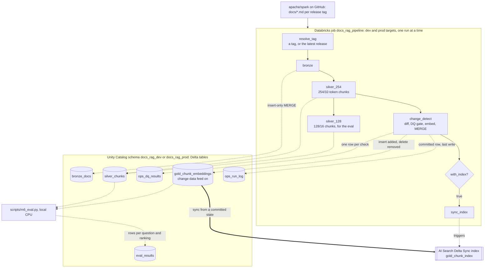
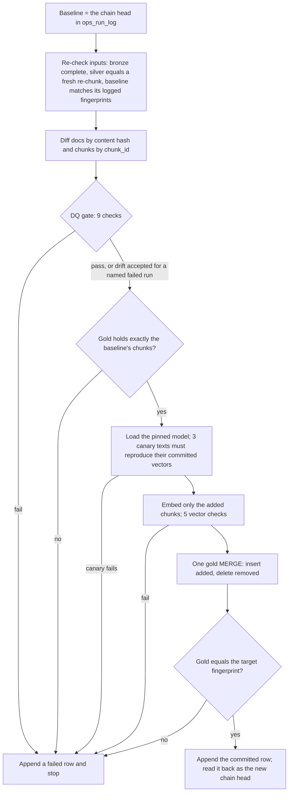

# Spark Docs RAG Pipeline

An incremental ingestion pipeline for retrieval-augmented generation (RAG). It keeps a table of embeddings, the
source of a vector index, in step with a changing document corpus. A harness measures how well the index
retrieves.

The corpus is the Apache Spark documentation: the Markdown under `docs/` in
[apache/spark](https://github.com/apache/spark), one release tag at a time. For the releases loaded here
(v3.5.0 to v4.2.0) that is 212–244 files and 5,400–6,100 chunks per release. Dev was taken through v3.5.0 → v4.0.0 → v4.0.1 → v4.2.0, and prod loaded
v4.2.0 from empty. The corpus is small on purpose: the point is handling change correctly, not throughput.

The stack is Databricks Free Edition: serverless jobs, Unity Catalog and Delta tables in a bronze/silver/gold
layout. The index is a Databricks AI Search (formerly Vector Search) Delta Sync index. Deployment uses
Databricks Asset Bundles with dev and prod targets, and GitHub Actions runs the tests and the deploys.

Every measured number here comes from a run whose raw output is committed under [`runs/`](runs/). The result
tables link their files; [`DECISIONS.md`](DECISIONS.md) cites the rest and records each design choice with the
options considered (D-001 to D-016).

## Results at a glance

- **Only changed chunks are embedded.** Across the three upgrades of dev, 2,689 of the 16,910 chunks in the
  target releases were embedded (15.9%); the patch release v4.0.1 needed 21 of 5,436. At this corpus size the
  gain is modest. The incremental v4.2.0 run billed 0.57 DBU against 1.23 for a full load, mostly saved in
  encoding (31 s against 221 s). Counting the drift-stopped run before it, dev's path to v4.2.0 billed 1.39
  (single runs; see [the comparison](#the-same-release-incremental-and-full)).
- **The incremental path ends where a full load ends.** Dev's gold table after three upgrades and prod's after
  one full load of v4.2.0 hold the same 6,051 chunk IDs. Dev's stored vectors give the same recall@5 and MRR@10
  as a fresh embedding on every eval question.
- **Re-runs change nothing.** A re-run on the same input logs 0 added, changed and deleted documents, embeds
  nothing and writes no new version of bronze, silver or gold, in dev and prod. It only appends its committed
  row to `ops_run_log` and its 9 check rows to `ops_dq_results`. The first bronze re-run still wrote an empty
  Delta version, which is why each write is now skipped when its input is identical.
- **A data-quality gate holds unusual loads for review before anything is embedded.** It runs 9 chunk checks
  and 5 vector checks, with thresholds set from 42 historical releases. It stopped both feature-release
  upgrades on drift. Both were real releases, accepted by re-running with the failed run's ID. It has not
  caught a bad load: deliberately corrupted silver rows were caught by a separate re-check.
- **Retrieval on 50 reviewed questions.** The production config scores lowest of the four on recall@5 and
  MRR@10 at both releases: recall@5 0.68 [0.54, 0.80] at v4.0.1, against up to 0.74 for bge-small. With n = 50, no recall@5 difference
  is significant. It stays because switching means re-embedding gold at about half the speed. The live ANN
  index returned 99.8% of exact search's top 10.
- **Cost.** Free Edition charges no money but enforces an undisclosed daily quota. Usage is billed in DBUs
  (Databricks Units), and one refusal fits a limit of roughly 63–90 DBU a day (an inference, D-001). A full
  run billed 1.23 DBU and a no-op run 0.36. An idle
  vector endpoint billed 96 DBU a day, so the endpoint and index are created only for demos.

## Architecture



"254/32" means chunks of at most 254 WordPiece tokens of embed text (heading breadcrumb plus body; the model's
256-token limit minus two special tokens), with up to 32 tokens of overlap within a section. Only 254/32 is published; 128/16 exists for the eval.

| Table | One row per | Key | Written by |
|---|---|---|---|
| `bronze_docs` | doc file of a tag: raw content, sha256, size, commit | `source_repo, version_tag, path` | `bronze`, insert-only MERGE |
| `silver_chunks` | chunk of a doc of a tag, per chunk config | `config_id, source_repo, version_tag, chunk_id` | `silver_254`, then `silver_128`, insert-only MERGE |
| `gold_chunk_embeddings` | published chunk of the current tag, with its 384-dim vector, the model and the run that embedded it | `chunk_id`, the index's primary key | `change_detect`: at most one MERGE per run, inserts and deletes only |
| `ops_run_log` | change-detection attempt, `committed` or `failed` | append-only; committed rows unique by `run_id` | `change_detect`, as its last write |
| `ops_dq_results` | DQ check of a run attempt | append-only: `run_id, attempt_id, check_name` | `change_detect` |
| `eval_results` | eval question × ranking (model, query prefix, chunk config, vectors) | 6 columns, insert-only MERGE | `scripts/m6_eval.py --write-table` (dev only) |

Committed rows in `ops_run_log` form a chain: each names the run it diffed against. The **chain head**, the
latest committed run, is the next run's baseline, so no comparison depends on timestamps.

### Inside `change_detect`: write, audit, publish



A failure before the MERGE leaves gold as it was. A failure after it leaves gold ahead of the chain, which the
next run detects and refuses (see Limitations). When nothing was added or removed, the run skips the model,
the vector checks and the MERGE. A **fingerprint** is a hash of the set of (path, chunk_id) pairs.

## How it works

**Bronze (D-006, D-007).** For a tag, the job downloads the source archive in one request, keeps
`docs/**/*.md`, checks the archive is complete and takes the commit from its header. A tag is an immutable
snapshot. Reloading a stored tag must reproduce it exactly (same paths, hashes and commit). If it does, the
write is skipped. If it does not, the run fails before writing, because a release tag should never change.

**Silver (D-008 to D-010).** Jekyll/Liquid markup is cleaned to plain Markdown text. Pages are split on their
headings, and each section into token-bounded chunks that never cross a section. A chunk's embed text is its
heading breadcrumb plus its body. Its `chunk_id` hashes the doc path, the section path, that exact text and an
occurrence counter, with no tag or position in it, so an unchanged section keeps its IDs in every release.
Each stored row is re-checked against its own content on every read. The cleaner and chunker are versioned,
and crossing a version is an explicit re-baseline (D-013).

**Change detection (D-011).** A run diffs the target tag against the chain head. Docs are compared by content
hash; chunks by ID. Added IDs are embedded, removed IDs are deleted from gold and kept IDs are left alone.
Every attempt that gets past its argument and environment checks appends a row to `ops_run_log` (a retry of
an already committed run writes nothing). A committed row carries the doc and chunk counts. A failed row
carries its error, and the totals it was gated on are in `ops_dq_results`.

**DQ gate (D-012).** Nine checks run on all of the target's chunks before anything is embedded:

| Check | Fails when |
|---|---|
| `empty_chunks` | any chunk has no tokens |
| `tiny_chunks` | more than 2% of chunks have bodies under 5 tokens |
| `oversized_chunks` | any chunk's embed text is over its config's limit or 254 tokens (the model's 256 less two special tokens) |
| `duplicate_chunk_ids` | any chunk ID repeats |
| `duplicate_embed_text` | more than 1% of chunks repeat another chunk's text |
| `missing_metadata` | a bad path, a blank section name, the wrong tag or a malformed commit |
| `drift_docs`, `drift_chunks`, `drift_tokens` | the total moves more than 5% (patch release) or 10% (minor or major) from the baseline |

Five vector checks then run on the newly embedded chunks before the MERGE. They fail on a missing or extra
vector, a wrong dimension, a non-finite value, a vector not of unit length, or the **canary**: three fixed texts
whose committed vectors the loaded model must reproduce. That catches a changed model or library. Only a drift
failure can be accepted, by re-running with a reason and the failed run's ID. The gate then accepts exactly
the numbers that run logged. A loss over 50% cannot be accepted.

**Gold and the index (D-014).** Embeddings come from `sentence-transformers/all-MiniLM-L6-v2` at a pinned
revision, computed by the job on CPU torch pinned by sha256. Gold rows are immutable and carry the run that
embedded them, so a verifier can prove which rows a run wrote. The index is a Delta Sync index over gold, with
vectors supplied by us. `jobs/sync_index.py` syncs it only when gold equals the chain head. The first sync,
when the index is created, is started by hand after a committed load. The index is a replica: a failed sync
leaves the run committed and is simply run again.

**Retrieval eval (D-015).** The eval set has 50 questions, one per sampled doc section. They were drafted by
an LLM (Claude) and checked by a second, skeptical pass. The owner then reviewed the set and kept all 50
([`eval/review_v1.json`](eval/review_v1.json)). Each item is labelled by a verbatim quote, not by chunk IDs. A
chunk is relevant if it covers at least half of an occurrence of the quote, so one label works for every chunk
size. Search is exact cosine over all chunks, with paired bootstrap intervals (10,000 resamples). The decision
rule was committed before the first run of the 50-item set.

**Orchestration and deployment (D-016).** One bundle (`databricks.yml`, `resources/pipeline.job.yml`) deploys
one job per target. The `tag` parameter defaults to `latest`, the highest-numbered vX.Y.Z release in git's ref
list; a maintenance release of an older line is not picked up. Every task refuses to start unless it imports
exactly the wheel version built from the deployed commit, on serverless environment 4. GitHub Actions runs
lint, types and tests on every push and pull request. It deploys dev on a push to `main`, unless the push
changes only run records, the eval set, `docs/` or Markdown. Prod deploys on demand.

**Operating it.** Runs are started by hand (`scripts/bundle.py run`). A weekly schedule (Mondays 06:15 UTC)
exists but is paused, because each run uses quota. A gate failure fails the job, which emails the deploying
user. It also appends a `failed` row to `ops_run_log` and one row per check to `ops_dq_results`. Query
`ops_dq_results` for that run to see which check failed and by how much. If only drift checks failed, accept
it by re-running with `accept_drift="<reason>" accept_drift_of=<job run id>-detect`; any other failed check has
to be fixed.

## Results

### Incremental processing (dev gold chain, 254/32, all-MiniLM-L6-v2)

| Run | Step | Docs added / changed / deleted | Chunks embedded | Kept | Removed | Share embedded |
|---|---|---|---|---|---|---|
| [`m5_c`](runs/m5_c_detect_v3.5.0_initial.json) | initial load, v3.5.0 | 244 / 0 / 0 | 5,567 | 0 | 0 | 100% |
| [`m5_h`](runs/m5_h_detect_v4.0.0_accepted.json) | v3.5.0 → v4.0.0 (major) | 19 / 96 / 51 | 1,866 | 3,557 | 2,010 | 34.4% |
| [`m5_j`](runs/m5_j_detect_v4.0.0_rerun.json) | v4.0.0 again | 0 / 0 / 0 | 0 | 5,423 | 0 | 0% |
| [`m5_k`](runs/m5_k_detect_v4.0.1.json) | v4.0.0 → v4.0.1 (patch) | 1 / 4 / 0 | 21 | 5,415 | 8 | 0.39% |
| [`m7_d`](runs/m7_d_dev_v4.2.0_accepted_detect.json) | v4.0.1 → v4.2.0 (minor), via the bundle job | 25 / 57 / 0 | 802 | 5,249 | 187 | 13.3% |
| [`m7_e`](runs/m7_e_dev_latest_again_detect.json) | `latest` (v4.2.0) again | 0 / 0 / 0 | 0 | 6,051 | 0 | 0% |

"Share embedded" is the chunks embedded divided by the chunks at the target. By tokens, the three upgrades
embedded 31.2%, 0.51% and 14.1%. Before two of them, the gate stopped a run on drift:
[`m5_d`](runs/m5_d_detect_v4.0.0_drift.json) (v4.0.0: docs −13.1%) and
[`m7_b`](runs/m7_b_dev_latest_detect.json) (v4.2.0: docs +11.7%, chunks +11.3%, tokens +12.1%). The upgrades
in the table are their accepted re-runs.

### The same release, incremental and full

| | Dev: incremental from v4.0.1 ([`m7_d`](runs/m7_d_dev_v4.2.0_accepted.json)) | Prod: full load from empty ([`m7_g`](runs/m7_g_prod_initial.json)) |
|---|---|---|
| Chunks embedded | 802 | 6,051 |
| Encoding time | 30.9 s | 220.7 s |
| `change_detect` task (start-up before the script) | 168 s (66 s) | 340 s (65 s) |
| Whole job | 308 s | 455 s |
| Billed DBU for the job run ([`m7_l`](runs/m7_l_billing_m7_runs.json)) | 0.57 | 1.23 |
| Gold after the run: chunks, fingerprint | 6,051, `671b1434…` | 6,051, `671b1434…` |

These are single runs. `m7_d` is not the whole incremental path. Bronze and silver 254/32 for dev's v4.2.0
were written by `m7_b` (0.82 DBU): the gate stopped its `change_detect`, and its silver 128/16 task failed on
a concurrent MERGE into silver. `m7_d` then wrote silver 128/16 (9,852 rows). On its own `m7_d` billed 47%
of the full load; counting both runs, dev's path to v4.2.0 billed 1.39 DBU, more than prod's full load. A
skipped write still costs its read: `m7_d` re-read bronze and re-chunked silver to find them identical.

Embedding is about half of a full run here (221 of 455 s) and a tenth of the incremental one (31 of 308 s).
The rest does not shrink with the change: task start-up and package installs (about 65 s of `change_detect`
in both runs), re-checking silver against a fresh re-chunk, and the gate. The last two were not timed
separately. What incremental processing buys at this size is a gold table and index that change only where
the docs changed, with per-vector lineage. That compute savings would grow with corpus size is an inference;
it was not measured.

### Data-quality gate

| Evidence | Result |
|---|---|
| Calibration: every final release from v3.0.0 to v4.2.0, chunked from git ([`m4_a`](runs/m4_a_calibration.json)) | No count check fired on any of 42 releases. Drift at 10% fired on 3 of 41 transitions, all feature releases. No patch release moved more than 2.2%. Hence 5% for a patch release and 10% for a minor or major one |
| Orchestrated stop and acceptance ([`m7_b`](runs/m7_b_dev_latest.json), [`m7_d`](runs/m7_d_dev_v4.2.0_accepted.json)) | `tag=latest` resolved to v4.2.0, and the gate failed the job before gold. The re-run with `accept_drift_of=<failed run>` committed and embedded 802 chunks |
| Corrupted silver ([`m2_d8b`](runs/m2_d8b_silver_v4.0.1_254_after_tamper.json), [`m4x_o`](runs/m4x_o_detect_v4.0.1_tampered_old_baseline.json)) | A hand-edited silver row failed its re-check (chunk_id does not match its content) and the run stopped. This is the input re-check, not the gate |
| Recomputed outside Databricks from the git tags | Every DQ row of every run checks out: dev 599/599 checks ([`m7_v1`](runs/m7_v1_gate_vs_git.json)), prod 152/152 ([`m7_v7`](runs/m7_v7_prod_gate_vs_git.json)). Change counts and gold's chunks match as well (dev [`m7_v2`](runs/m7_v2_changes_vs_git.json), [`m7_v3`](runs/m7_v3_dev_gold_vs_git.json); prod [`m7_v8`](runs/m7_v8_prod_changes_vs_git.json), [`m7_v9`](runs/m7_v9_prod_gold_vs_git.json)), and a sample of 200 rows per gold table, re-embedded, reproduces its vectors (lowest cosine 0.99998) |

The verifiers reuse the pipeline's chunker and token counting, so they are independent of Databricks, not of
the core logic. Vector-check rows are checked for presence and a pass; the vectors themselves are checked by
the re-embedding sample.

### Retrieval (50 questions, exact search, 95% bootstrap intervals)

| Configuration | recall@5 at v4.0.1 | MRR@10 at v4.0.1 | recall@5 at v4.2.0 | MRR@10 at v4.2.0 |
|---|---|---|---|---|
| all-MiniLM-L6-v2, 254/32 (production) | 0.68 [0.54, 0.80] | 0.486 [0.378, 0.597] | 0.66 [0.52, 0.78] | 0.462 [0.352, 0.575] |
| all-MiniLM-L6-v2, 128/16 | 0.72 [0.60, 0.84] | 0.500 [0.390, 0.612] | 0.70 [0.56, 0.82] | 0.477 [0.365, 0.590] |
| bge-small-en-v1.5, 254/32, with its query instruction | 0.74 [0.62, 0.86] | 0.581 [0.464, 0.696] | 0.74 [0.62, 0.86] | 0.541 [0.427, 0.656] |
| bge-small-en-v1.5, 128/16, with its query instruction | 0.74 [0.62, 0.86] | 0.607 [0.485, 0.727] | 0.72 [0.58, 0.84] | 0.576 [0.453, 0.694] |
| production config through the live AI Search index | 0.68 [0.54, 0.80] | 0.489 [0.381, 0.600] | not run | not run |

Sources: [`m6_i`](runs/m6_i_eval_v1.json) (v4.0.1) and [`m6_n`](runs/m6_n_eval_v2.json) (v4.2.0: the same 50
questions; one quote updated where the release reformatted it, q19's NULL in backticks). The rows are saved
in `eval_results`.

- **The decision rule, fixed in advance:** a difference counts only if its paired 95% interval for recall@5
  excludes zero. None of the comparisons named in the plan clears that bar at either release. So production
  stays on the model that is already embedded and twice as fast to embed (64.7 against 33.8 chunks/s on the eval
  machine's CPU at 254/32).
- On MRR@10, bge-small with its instruction led production by +0.095 [+0.009, +0.186] at v4.0.1. At v4.2.0,
  eight releases later, the same lead was +0.080 [−0.001, +0.164] and no longer cleared zero.
- The serving path loses nothing measurable. Gold's vectors put each question's first relevant chunk at the
  same rank as a local embedding whenever it is in the top 10, so recall@5 and MRR@10 are identical (lowest
  cosine 0.99997). The ANN index returned 99.8% of exact search's top 10, with identical
  lists for 48 of the 50 questions.
- Retrieval is weakest on the SQL reference pages: at v4.0.1, recall@5 0.61–0.70 for these configurations
  against 0.70–0.85 elsewhere (0.61–0.65 on SQL reference at v4.2.0). A likely cause, not tested: those pages
  are many short docs built from one template, so near-identical chunks compete.

## Run it

Requirements: Python 3.12 and [uv](https://docs.astral.sh/uv/). For Databricks, a workspace (Free Edition
works) with `DATABRICKS_HOST` and `DATABRICKS_TOKEN` set, and the Databricks CLI 1.21.0 or later on `PATH`, or
named by `DATABRICKS_CLI`.

```bash
# Local checks (no workspace; the tests need no network)
uv sync
uv run pytest
uv run ruff check . && uv run ruff format --check .
uv run mypy src
uv run python scripts/corpus_fingerprint.py   # the real corpus as a golden: fetches the docs from GitHub, ~1 min

# Deploy: builds the wheel from the current commit, creates the schema and Volume, deploys the job
uv run --with databricks-sdk==0.152.0 python scripts/bundle.py deploy --target dev

# Run the job. A schema's first run needs initial=true. --label names the record written to runs/.
uv run --with databricks-sdk==0.152.0 python scripts/bundle.py run --target dev --label first_load -- \
    tag=v4.0.1 initial=true
uv run --with databricks-sdk==0.152.0 python scripts/bundle.py run --target dev --label upgrade -- tag=latest

# If the gate stops a run on drift: read the numbers in ops_dq_results, then accept them for that run
uv run --with databricks-sdk==0.152.0 python scripts/bundle.py run --target dev --label upgrade_accepted -- \
    tag=latest accept_drift="<why this drift is expected>" accept_drift_of=<failed job run id>-detect

# Recompute the gold chain's DQ rows and change counts from git (add --schema docs_rag_prod for prod).
# --job-runs takes every change_detect record of the chain, failed runs included.
uv run --with databricks-sdk==0.152.0 python scripts/m4_verify_gate.py --label gate_check \
    --sink gold_chunk_embeddings --job-runs runs/first_load_detect.json runs/upgrade*_detect.json
uv run --with databricks-sdk==0.152.0 python scripts/m3_verify_changes.py --label change_check \
    --sink gold_chunk_embeddings --job-runs runs/first_load_detect.json runs/upgrade*_detect.json

# The retrieval eval: local CPU, about 10 minutes; reads silver and gold, writes eval_results
uv run --with databricks-sdk==0.152.0 --with sentence-transformers==6.1.0 --with transformers==5.19.0 \
    --with torch==2.14.1+cpu --index https://download.pytorch.org/whl/cpu --index-strategy unsafe-best-match \
    python scripts/m6_eval.py --label eval_run --set eval/eval_set_v2.json --write-table
```

From M1 on, the tooling refuses to run on uncommitted code, so each record names the commit it ran. What it
writes to `runs/` is redacted first. The index demo (`scripts/m5_index.py`, then a `with_index=true` run) costs
quota while the endpoint exists: create it only for a demo and delete it afterwards.

## Limitations

1. **The eval set is small.** With 50 questions the paired recall@5 intervals are about ±5 to ±12 points.
   Halving them needs about four times the items, roughly 200 (an inference: intervals shrink with 1/√n).
   MRR findings are not stable at this size either: of the leads that cleared zero at v4.0.1, the one at
   254/32 did not at v4.2.0 (D-015).
2. **The eval's labels are narrow.** It covers one section per sampled doc, and its questions were
   LLM-drafted. For 8 items the answer also appears, in other words, in another doc; retrieving that doc
   counts as a miss (D-015 reports the set both ways). These cross-doc matches were not re-reviewed for docs
   added after v4.0.1.
3. **Section-aware chunking was not compared with whole-page chunking on retrieval** (D-009, D-015). It was
   compared on re-embedding cost, and did not win: 2.6% more new tokens at 254/32 and 19% more at 128/16 for
   v3.5.0 → v4.0.0 ([`m2_e`](runs/m2_e_stability.json)).
4. **The index exists only during demos.** An idle endpoint billed 96 DBU a day
   ([`m2_b`](runs/m2_b_billing_usage_reprobe.json)), more than the inferred daily quota (D-001). Incremental
   syncs ran twice, in M5 ([`m5_i`](runs/m5_i_sync_after_v4.0.0.json), `m5_l`), as one-off runs of
   `jobs/sync_index.py` on a slightly earlier version of it. The bundle's `sync_index` task has never run, and
   prod has never had an index.
5. **One failure needs a manual repair.** If a run fails between the gold MERGE and its committed row, the next
   run refuses to proceed, because gold no longer matches the chain head. The repair is manual and untested
   (D-014).
6. **Scheduling is not hands-off.** The schedule is paused. A run the gate stops would fail every week until
   someone accepts the drift; repeat failures are not short-circuited. Whether the failure email arrived was
   not checked (D-012, D-016).
7. **The DQ checks are structural.** They cover counts, sizes, duplicates, metadata and drift, calibrated on
   this one corpus. They say nothing about whether a chunk is good text, and an override's reason is checked
   only for length (D-012, D-013).
8. **Deployment security is basic.** CI uses a personal access token, not OAuth or OIDC federation, and prod
   runs as the owner, not a service principal. When prod was first deployed from Actions, the `prod` GitHub
   environment required no reviewer ([`m7_j`](runs/m7_j_actions_deploy_prod.json)).
9. **Cost and timing figures are single runs** on shared serverless compute, with no repeats.
10. **The two silver writes run in sequence.** Run in parallel, their MERGEs into one table conflicted
    (`m7_b`). Partitioning or clustering silver by config, with the MERGE filtered on it, might allow parallel
    writes; that is untested (D-016).

## Repository layout

```
databricks.yml, resources/   Asset Bundle: targets and the job
jobs/                        Databricks job scripts, thin adapters over the core
src/docs_rag/                pure-Python core: fetch, clean, chunk, diff, DQ, gold plan, eval metrics (no pyspark)
scripts/                     local tooling: deploy and run, one-off jobs, SQL, verifiers, eval, redaction
tests/                       pytest, no network: small fixtures and goldens
eval/                        the eval sets and the owner's review
runs/                        raw output of the runs whose numbers are cited here and in DECISIONS.md
DECISIONS.md                 every significant choice: options, decision, evidence
```

CI runs link to GitHub Actions. A few observations in `DECISIONS.md` are marked as not saved.

## Attribution

The corpus is the Apache Spark documentation, under the Apache License 2.0. The excerpts this repository
redistributes (test fixtures, the eval set, the canary texts) are listed in
[`THIRD_PARTY_NOTICES.md`](THIRD_PARTY_NOTICES.md), and the license text is in [`LICENSES/`](LICENSES/). The
embedding models are all-MiniLM-L6-v2 and bge-small-en-v1.5, used through sentence-transformers.
